# XCoderMac 软件界面截图

以下截图来自 macOS 上实际启动的 XCoderMac Avalonia 程序，使用应用自身的 UI 渲染生成。
这是界面静态截图，不代表所有协议、外设与数据库功能已经通过端到端验收。

原始 26 工具截图拍摄于 2026-10-18；此后部分窗口及样式截图已更新至 0.3.3。截图仅用于 UI 参考，不作为业务验收证据。

| 编号 | 页面 | 状态 | 文件 |
|---|---|---|---|
| 00 | 主页 | 成功 | [查看截图](./00-首页.png) |
| 01 | 数据建模 | 成功 | [查看截图](./01-数据建模.png) |
| 02 | 数据同步 | 成功 | [查看截图](./02-数据同步.png) |
| 03 | API 调试 | 成功 | [查看截图](./03-API 调试.png) |
| 04 | API 发现 | 成功 | [查看截图](./04-API 发现.png) |
| 05 | 正则表达式 | 成功 | [查看截图](./05-正则表达式.png) |
| 06 | 加密解密 | 成功 | [查看截图](./06-加密解密.png) |
| 07 | 文件编码 | 成功 | [查看截图](./07-文件编码.png) |
| 08 | 网络工具 | 成功 | [查看截图](./08-网络工具.png) |
| 09 | 消息调试 | 成功 | [查看截图](./09-消息调试.png) |
| 10 | MQTT 客户端 | 成功 | [查看截图](./10-MQTT 客户端.png) |
| 11 | Modbus TCP | 成功 | [查看截图](./11-Modbus TCP.png) |
| 12 | Modbus RTU | 成功 | [查看截图](./12-Modbus RTU.png) |
| 13 | 串口工具 | 成功 | [查看截图](./13-串口工具.png) |
| 14 | SSH 工具 | 成功 | [查看截图](./14-SSH 工具.png) |
| 15 | Redis 管理 | 成功 | [查看截图](./15-Redis 管理.png) |
| 16 | IP 设置 | 成功 | [查看截图](./16-IP 设置.png) |
| 17 | USB 设备 | 成功 | [查看截图](./17-USB 设备.png) |
| 18 | 声卡选择 | 成功 | [查看截图](./18-声卡选择.png) |
| 19 | I/O 控制 | 成功 | [查看截图](./19-I-O 控制.png) |
| 20 | 图标水印 | 成功 | [查看截图](./20-图标水印.png) |
| 21 | 文件夹统计 | 成功 | [查看截图](./21-文件夹统计.png) |
| 22 | GPS 辅助 | 成功 | [查看截图](./22-GPS 辅助.png) |
| 23 | 地图接口 | 成功 | [查看截图](./23-地图接口.png) |
| 24 | 手机备份 | 成功 | [查看截图](./24-手机备份.png) |
| 25 | 语音助手 | 成功 | [查看截图](./25-语音助手.png) |
| 26 | 梅尔频谱 | 成功 | [查看截图](./26-梅尔频谱.png) |

## 主页

## 管理快捷入口

## 工作台：已打开工具与统一状态栏

### 已打开工具悬停状态

## 数据建模

不同窗口宽度下的附加截图：

- [小窗口顶部布局](./01-数据建模-小窗口.png)
- [小窗口滚动到底部的表结构](./01-数据建模-小窗口-表结构.png)

### 模型管理与 SQL 工具（当前界面）

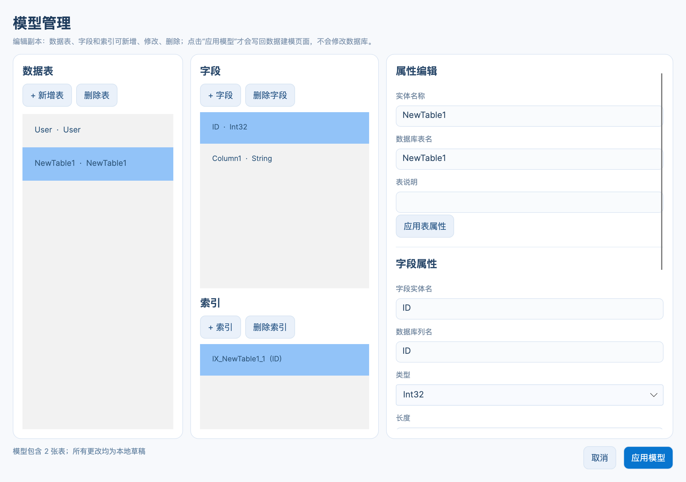

### SQL 工具交互与字体（0.3.3）

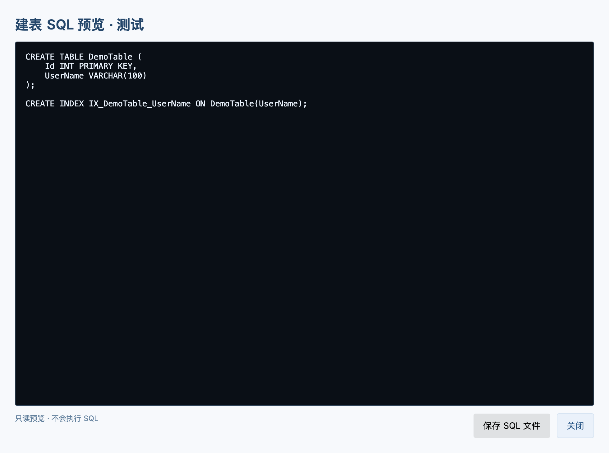

## 文件编码（2026-10-20 布局调整）

## 数据同步

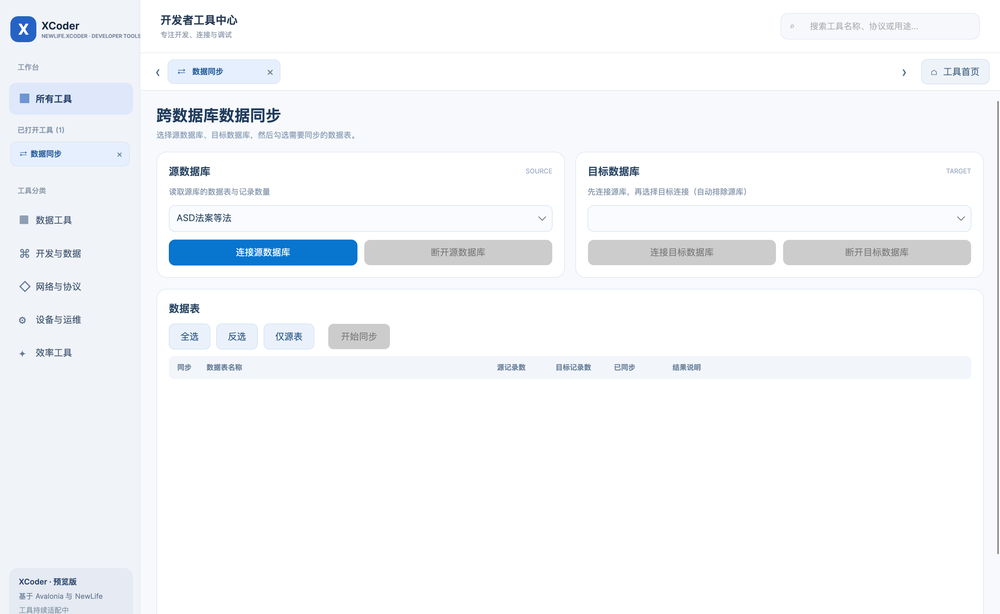

## API 调试

### 黑色交互日志控制台

### RPC Action 空列表说明（2026-10-20）

### 网络工具默认绑定地址（2026-10-20）

### 消息调试连接栏（2026-10-20）

### MQTT 客户端顶部三卡/底部全宽高日志（2026-10-20 第二轮）

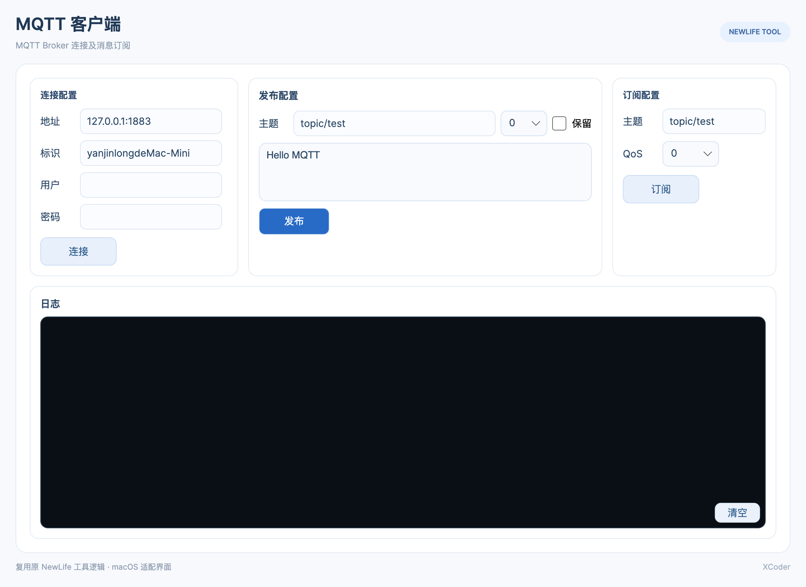

## API 发现

### 按钮悬停与服务列表/日志圆角（2026-10-20）

## 正则表达式

## 加密解密

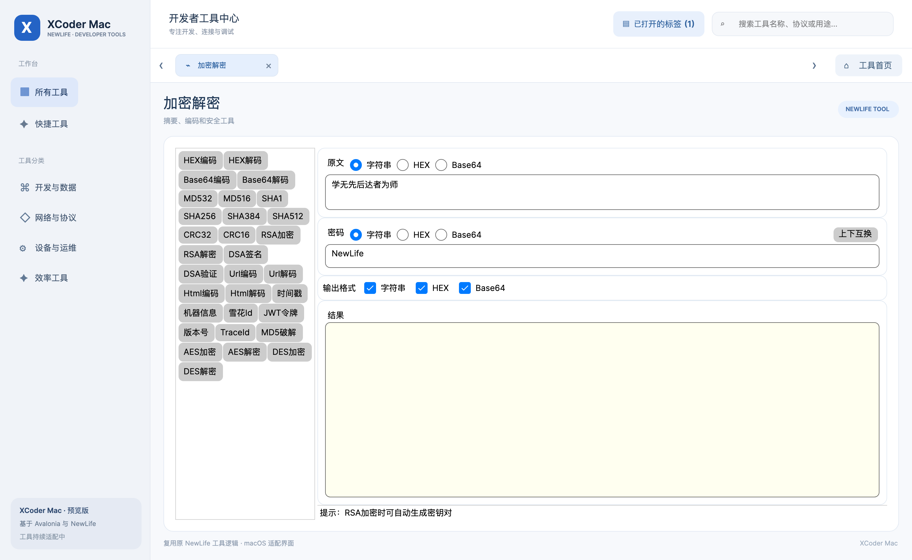

### 全项目间距规则与加密解密流按钮实测（2026-10-20）

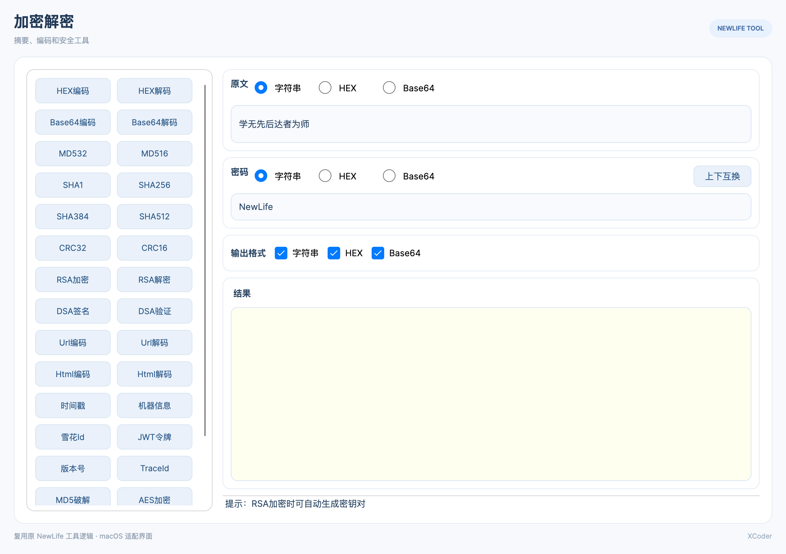

### 非法解码输入：不再闪退

## 文件编码

## 网络工具

## 消息调试

## MQTT 客户端

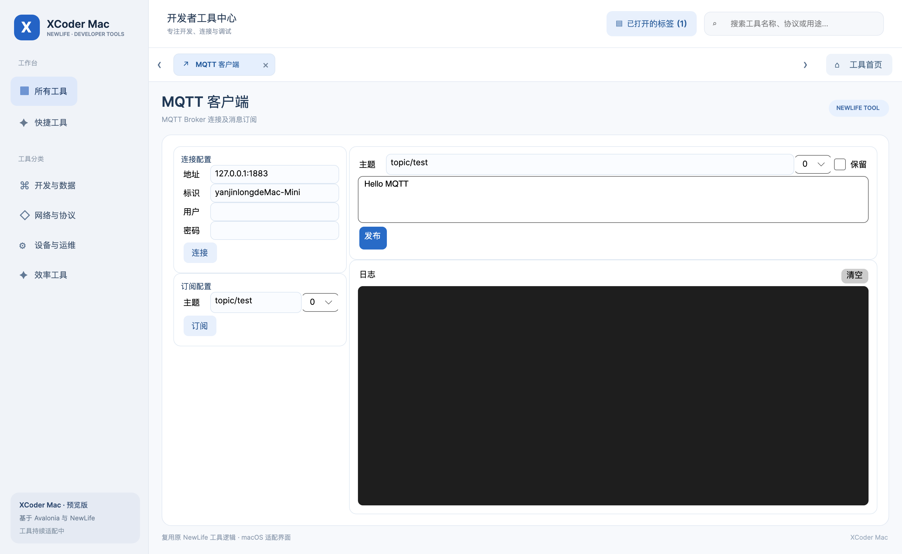

## Modbus TCP

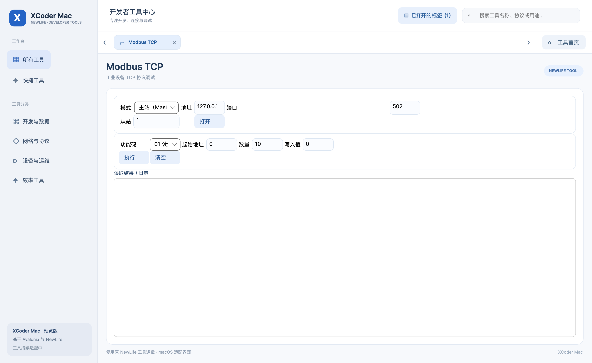

## Modbus RTU

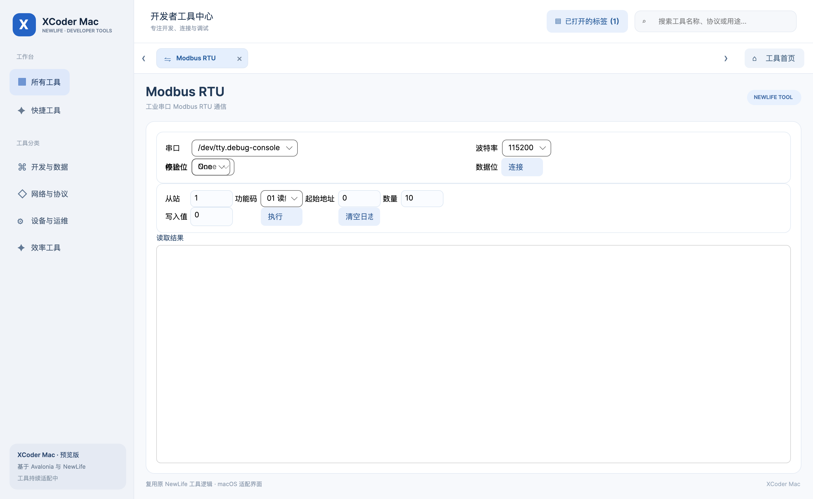

## 串口工具

## SSH 工具

## Redis 管理

## IP 设置

## USB 设备

## 声卡选择

## I/O 控制

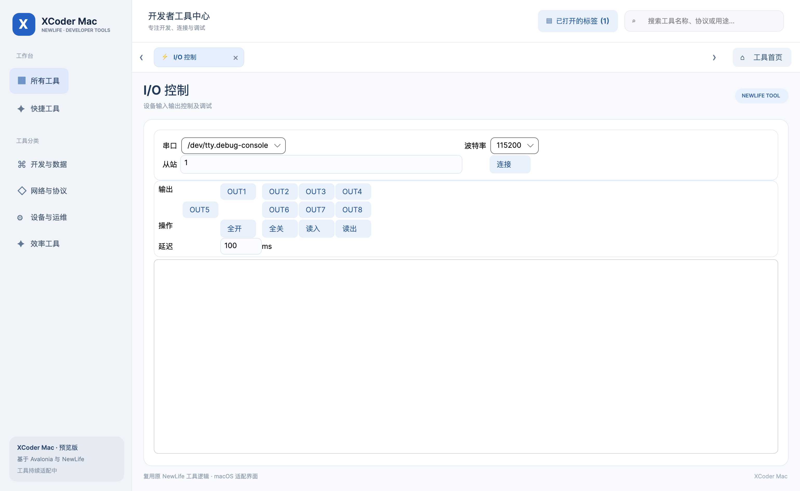

## 图标水印

## 文件夹统计

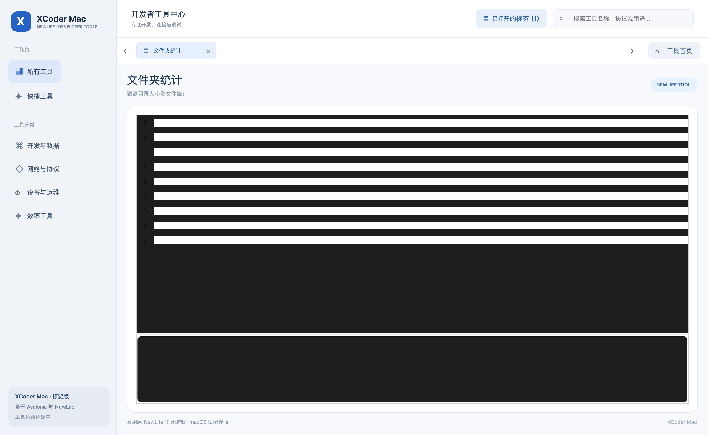

## GPS 辅助

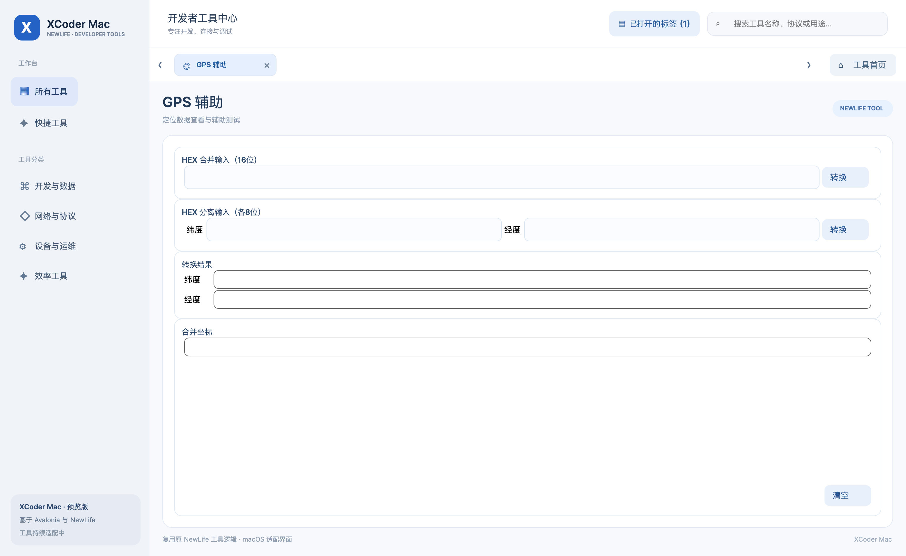

## 地图接口

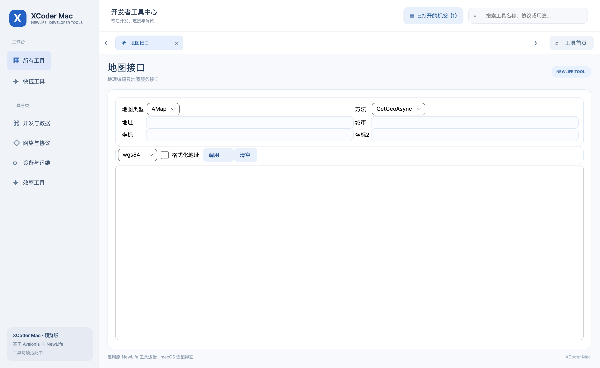

## 手机备份

## 语音助手

## 梅尔频谱

## 数据库连接配置

### 数据库连接字符串双向同步示例

## 数据同步页面自适应布局

